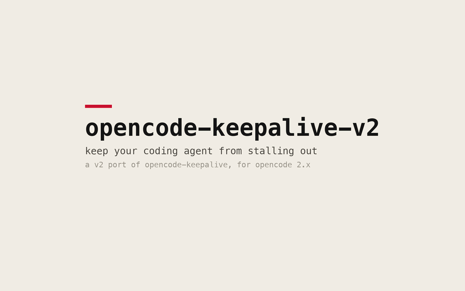

# opencode-keepalive-v2

keep your coding agent from stalling out ~ a port of [opencode-keepalive](https://github.com/joeyism/opencode-keepalive) that loads on opencode 2.x.



the gif is real plugin output from a scripted stall ([how it's made](tools/demo)).

joeyism's plugin targets the v1 plugin api (`export default (ctx) => hooks`), so opencode 2.x refuses to load it:

```
Plugin must export a default definition with an id and an effect or setup function.
```

this repo keeps that engine as-is and adds a small adapter, `src/index.js`, for the v2 api.

## what it does

- appends a heartbeat to a local ndjson log every 10s (configurable), so a watchdog or `tail -f` can see the agent is alive.
- notices when a session is busy but hasn't made progress for `stallMs`.
- with `childStallAction: "abort-resume-parent"`, aborts a stuck subagent and nudges its parent to pick the work back up. it never aborts your main session.

## install

clone it into your opencode config dir:

```bash
git clone https://github.com/k0nnect/opencode-keepalive-v2 \
  ~/.config/opencode/local-plugins/opencode-keepalive-v2
```

add it to `~/.config/opencode/opencode.jsonc`:

```jsonc
{
  "plugins": [
    {
      "package": "./local-plugins/opencode-keepalive-v2",
      "options": { "childStallAction": "abort-resume-parent" }
    }
  ]
}
```

then restart opencode. heartbeats go to `~/.local/state/opencode-keepalive/heartbeat.ndjson` by default.

## options

| option | default | what it does |
|---|---|---|
| `intervalMs` | `10000` | heartbeat cadence in ms |
| `stallMs` | `120000` | how long a busy session can make no progress before it counts as stalled |
| `childStallAction` | `report` | `report` (log only) or `abort-resume-parent` (abort the stuck subagent and nudge its parent) |
| `maxStallRecoveries` | `3` | cap on automatic recoveries per subagent |
| `output` | `file` | `file`, `stdout`, `stderr`, or `none` |
| `logFile` | `~/.local/state/opencode-keepalive/heartbeat.ndjson` | where the ndjson goes when `output` is `file` |

to watch it live:

```bash
tail -f ~/.local/state/opencode-keepalive/heartbeat.ndjson | jq .
```

## how the port works

opencode 2.x expects `export default { id, setup }` and moved the plugin api onto the context object. the adapter:

- wraps the engine in `{ id, setup }`.
- feeds the old `event` hook from `ctx.event.subscribe()`, and `tool.execute.before` / `tool.execute.after` from `ctx.tool.hook(...)`.
- maps the removed `ctx.client.session.*` calls onto `ctx.session.*`, so the abort and the parent nudge still work.
- runs one copy of the engine per process. opencode can load a local plugin from more than one path, and without that guard every heartbeat and recovery would happen twice.

## credits

the engine is [opencode-keepalive](https://github.com/joeyism/opencode-keepalive) by [joeyism](https://github.com/joeyism), copied unchanged into `src/` under mit. this repo adds `src/index.js`. see [`NOTICE`](NOTICE).

## license

[mit](LICENSE)
